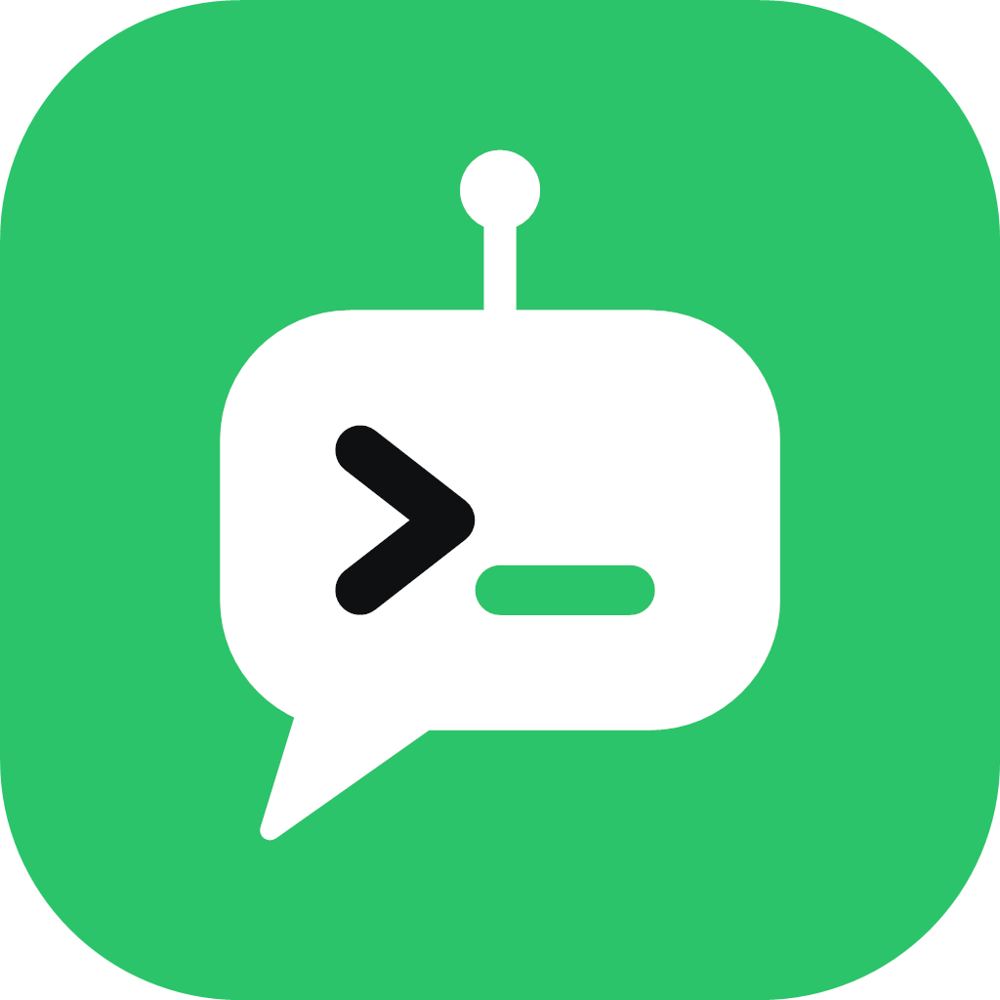

<p align="center"></p>

<h1 align="center">VoxPilot</h1>

<p align="center">
  Aynı anda çalışan yapay zekâ kodlama oturumları (Claude Code, Codex, Antigravity) için HUD: her oturum canlı bir
  yörünge haritasında, her sohbet kendi penceresinde.
</p>

## Neler yapar

- **Bütün Claude Code oturumları tek ekranda.** Çalışan, sırası sana gelen ve onay bekleyen oturumlar ayrı renkte;
  alt ajanlar, araç çağrıları, dokunulan dosyalar, web araştırması, token ve harcama (API liste fiyatıyla) canlı.
- **Codex ve Antigravity de.** Kendi kayıtlarından okunur; terminalde çalışan diğer yapay zekâ araçları da gezegen olur.
- **Her sohbet kendi penceresinde**, arka planda süren bir oturumda: pencereyi ya da uygulamayı kapatsan da ajan
  çalışmaya devam eder, pencere geçmişiyle geri gelir.
- **Terminaller** (geliştirme sunucuları, testler) yörüngede araba olarak dolaşır, boşta park eder.
- **Kaynak kontrolü**: oturumların çalıştığı her depo için değişiklikler, commit, geçmiş ve farklar.
- **Temalar**: varsayılan VoxPilot teması (yeşil, mor, siyah) ve 12 renk teması, terminaller dahil.

## Gizlilik

- Claude Code'un dosyalarını (`%USERPROFILE%\.claude`), Codex'in ve Antigravity'nin kayıtlarını yalnızca okur;
  hiçbiri bilgisayardan çıkmaz.
- Sunucusu yok: hiçbir yere veri göndermez, kendiliğinden güncelleme indirmez. Arkadaşlar, mesajlar ve seviyeler bir
  sunucuya bağlanınca çalışır (`VOXPILOT_API_URL`).
- Claude Code'un, Codex'in ve Antigravity'nin ayar dosyalarına kendiliğinden hiçbir şey yazmaz. Token tasarrufu (rtk,
  caveman), yapay zekâ araçlarını temanın renkleriyle boyama ve üst çubuktaki Claude limitleri Ayarlar'dan açılır;
  kapatınca geri alınır.

## Windows için derleme

```sh
cd windows
npm install          # node-pty hazır derlenmiş gelir
npm start            # kaynaktan çalıştırır
npm run dist         # windows/dist/VoxPilot-Setup-<sürüm>.exe
```

Yörünge haritası değişince: `cd app/orbit && npm install && npm run build` (çıktı `app/Resources/web/orbit.js`).
`app/` altındaki Mac sürümü bu depoda duruyor; VoxPilot'a uyarlanması ve derlenmesi için Mac gerekir.

## Lisans

MIT, `LICENSE` dosyasına bak.
